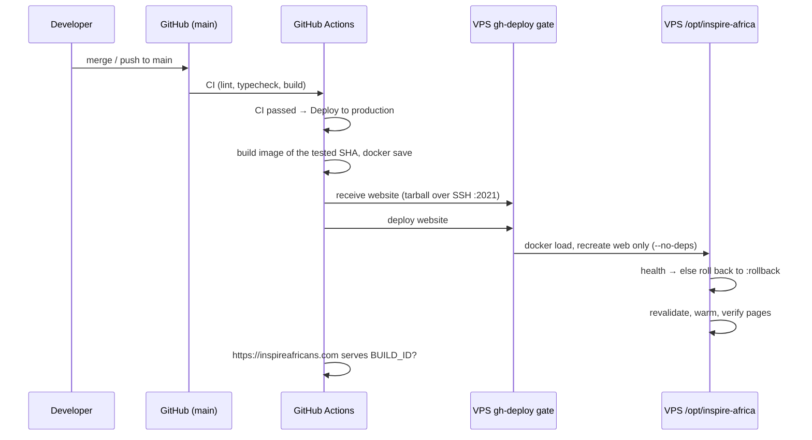

# CI/CD

> Purpose: the GitHub Actions workflows for both repos — triggers, steps, image tags, secrets.
> Last reviewed: 2026-11-05 (website moved to deploy-on-merge, `docker-publish.yml` removed)

## Table of contents
- [1. Overview](#1-overview)
- [2. Website workflows](#2-website-workflows)
- [3. CMS workflow](#3-cms-workflow)
- [4. Build → deploy sequence](#4-build--deploy-sequence)
- [5. Secrets & permissions](#5-secrets--permissions)

---

## 1. Overview

The website deploys itself the same way as the register and readiness: **merging to `main` deploys**. Its three workflows:

| Workflow | File | Does |
|----------|------|------|
| CI | `ci.yml` | lint, typecheck, production build on every push to `main` and every PR; on PRs also a Docker build (no push) |
| Deploy to production | `deploy.yml` | after CI passes on a push to `main`: builds the image of that commit and ships it to the VPS through the `gh-deploy` gate |
| Mirror to personal repository | `mirror.yml` | copies branches and tags to `Bahindiemma/inspire-africa-website` (org-wide policy, not a deploy) |

Website builds are **no longer published to GHCR**. The image is built in the deploy run, handed over as a `docker save` tarball and loaded on the server under the name its compose file runs (`ghcr.io/bahindiemma/inspire-africa-website:latest`). The CMS still publishes to GHCR (section 3).

## 2. Website workflows

**`ci.yml`**: `npm ci` → `npm run lint` → `npm run typecheck` → `npm run build` (whose `prebuild` runs the join-gate source scan), with placeholder `.invalid` origins so no CMS or secret is needed. Org repository only.

**`deploy.yml`**:
- **Triggers**: `workflow_run` of CI completing on `main` (deploys only a *successful* run of a *push*), and `workflow_dispatch` with a `ref` (branch, tag or full SHA) for redeploys and rollbacks.
- **Guards**: org repository only; skips a commit `main` has moved past; refuses a commit whose CI has not passed; `concurrency: deploy-production-website`, never cancelled mid-deploy.
- **Steps**: checkout the tested SHA → buildx build with `NEXT_PUBLIC_SITE_URL` and `STRAPI_MEDIA_URL` = `https://inspireafricans.com` (GHA cache) → read `/app/.next/BUILD_ID` from the image → `docker save | gzip` → `ssh gh-deploy@VPS receive website < app.tgz` → `ssh gh-deploy@VPS deploy website` → poll https://inspireafricans.com/ until it serves this BUILD_ID.
- **On the server** (`inspire-deploy website`, root-owned, in `inspire-africa-community-vault/deploy/github-actions/`): one deploy at a time across all Inspire apps (flock); checks `/opt/inspire-africa` runs that image name for `web`; `docker load`; `docker compose up -d --no-deps --force-recreate --pull never web`; confirms the container runs the new image and answers; otherwise puts the previous image (kept as `:rollback`) back; revalidates every CMS page and collection; warms each page twice; verifies photographs and gated join links on every page; removes only the image from two deploys ago (shared host: never a global prune). Log: `/var/log/inspire-deploy.log`.

## 3. CMS workflow

Source: `inspire-africa-cms/.github/workflows/docker-publish.yml`.

- **Triggers**: `push` to `main` (ignoring `**.md`, `docs/**`, `render.yaml`), and `workflow_dispatch`.
- **Permissions**: `contents: read`, `packages: write`.
- **Steps**: checkout → GHCR login → metadata → buildx → build-push. No `NEXT_PUBLIC_*` build-arg (Strapi reads env at runtime).
- **Dockerfile**: 3-stage (builder with `npm ci --legacy-peer-deps` + `vips-dev` for sharp → prod-deps-only → runner with `vips` + `tini`, non-root `node`, `npm run start`, EXPOSE 1337).

## 4. Build → deploy sequence

## 5. Secrets & permissions

- **Website repo secrets** (same names as readiness and the register): `DEPLOY_SSH_KEY` (the website's own key, pinned on the server to `inspire-deploy-gate website`: it can hand over and deploy the website and nothing else; no shell), `DEPLOY_KNOWN_HOSTS`, `DEPLOY_HOST`, `DEPLOY_PORT`. `MIRROR_SSH_KEY` for the mirror.
- **Workflow permissions**: `contents: read`, `actions: read` (to read CI results). No `packages: write`: nothing is pushed to GHCR.
- **Server side**: installed once, as root, by `provision-gh-deploy.sh` in the vault repo (`keep keep keep "<website key>"` adds the website to a server that already deploys the others).
- **App secrets** (DB passwords, Strapi secrets, tokens) are **not** in CI. They live only in `/opt/inspire-africa/.env` on the VPS (see [Environment variables](./10-environment-variables.md) and [Deployment runbook](./12-deployment-runbook.md)).
- **CMS**: `GITHUB_TOKEN` pushes its image to GHCR (`packages: write`). The `cms` package is PRIVATE: the server logs in with a `read:packages` PAT or builds on-host (ADR-008).
- **Never `docker compose pull web`** (or a bare `docker compose pull`) on the server: the website is no longer in GHCR, so a pull would bring back an old build.
